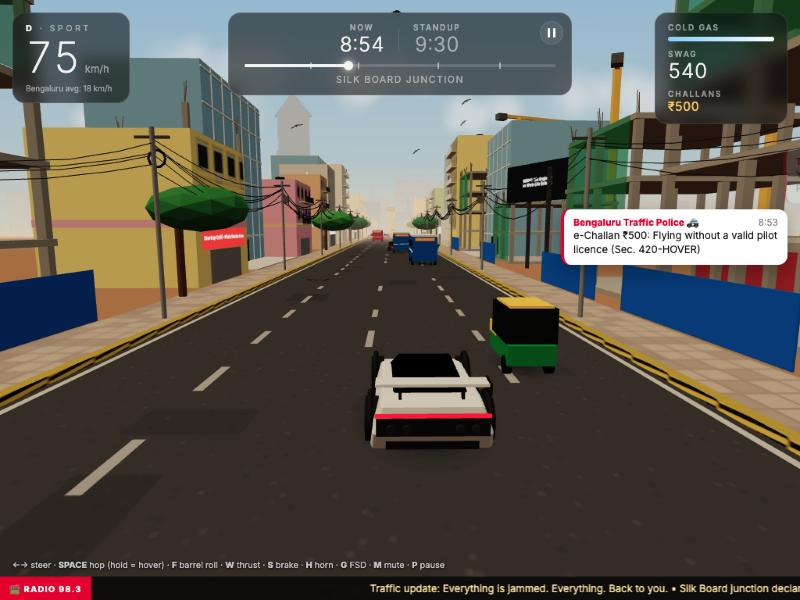
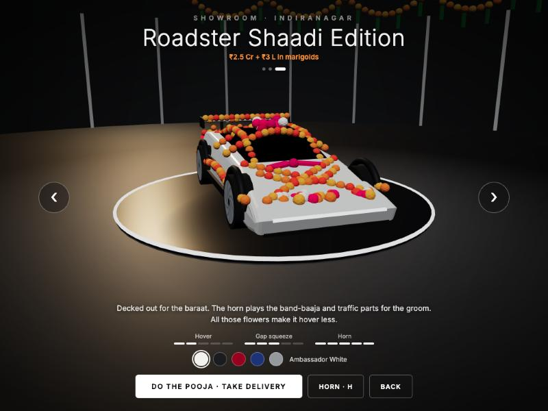

# Roadster: Namma Bengaluru Edition

You just took delivery of a ₹2.5 crore flying Roadster. You still have to get from HSR Layout to Whitefield by the 9:30 AM standup. Through Silk Board.

A small browser game: Tesla minimalism versus Bengaluru chaos. Hop over autos, hover across the Silk Board gridlock on cold-gas thrusters, barrel-roll over BMTC buses, and fly over cows to show respect.

**▶ Play: https://thevarun.github.io/roadster-bengaluru/**

15-second gameplay clip: [media/roadster-bengaluru-clip.mp4](media/roadster-bengaluru-clip.mp4)



## Controls

| Key | Action |
| --- | --- |
| ← → / A D | Steer (lanes are a suggestion) |
| Space | Hop · hold to hover |
| F | Barrel roll (in the air) |
| W / ↑ | Rear thrusters (uses cold gas) |
| S / ↓ | Brake |
| H | Horn |
| G | FSD (Supervised). Good luck. |
| P / Esc | Pause |
| M | Mute |

Phones get on-screen touch controls. Drive modes (Chill / Sport / Plaid) change cruise speed. The clock scales with the mode, so Chill isn't a handicap.

## The showroom

Open it with **Enter the showroom** on the title screen, or **Change car** from the pause menu. Swap cars with ‹ › (or ← →), and press H to test the horn.

| Car | Plays like | Horn |
| --- | --- | --- |
| Roadster | The launch-event car. Balanced. | Premium dual-tone |
| Roadster Kaali-Peeli | A Mumbai taxi on ORR. Squeezes through gaps. | Old-taxi "paarp" |
| Roadster Shaadi Edition | Buried in marigolds. Hovers less, parts traffic. | Band-baaja |

Taking delivery of a new car includes a lemon-and-coconut pooja.



## Route

HSR Layout → Silk Board Junction → Outer Ring Road / Bellandur → Marathahalli Bridge → Whitefield.

## Run locally

No build step. It's static files, but ES modules need a local server:

```bash
python3 -m http.server 8742
```

Open http://localhost:8742. Pushing to `main` deploys to GitHub Pages.

## Tech

- [Three.js](https://threejs.org) r160 from a CDN, with low-poly, flat-shaded geometry built in code. There are no models or textures; signs are drawn on canvas.
- Horns are real recordings (see Credits). Everything else is synthesised with WebAudio: moo, thrusters, band-baaja, temple bell. If a recording fails to load, that horn falls back to synth.
- `game.js` holds the whole game: world, traffic AI, physics, showroom, HUD and audio. `CLAUDE.md` has notes for coding agents.

## Credits

Horn recordings by Joseph Sardin, [BigSoundBank](https://bigsoundbank.com), released under CC0 (public domain):

- `audio/roadster-horn.mp3`: 4th honk of [Klaxons inside car](https://bigsoundbank.com/klaxons-inside-car-s0558.html)
- `audio/taxi-horn.mp3`: [Old car horn #3](https://bigsoundbank.com/old-car-horn-3-s0256.html)
- `audio/car-horn.mp3`: [Car horn #4](https://bigsoundbank.com/car-horn-4-s0260.html) (also pitched up for autos and two-wheelers)
- `audio/bus-horn.mp3`: [Bus horn](https://bigsoundbank.com/bus-horn-s3594.html)
- `audio/truck-horn.mp3`: [Truck Horn](https://bigsoundbank.com/truck-horn-s2721.html)

---

Fan-made parody. Not affiliated with Tesla, SpaceX, BMTC, or any cow.
