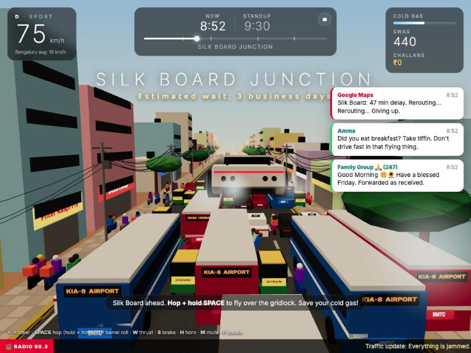

# Roadster: Namma Bengaluru Edition

You just took delivery of a ₹2.5 crore flying Roadster. You still have to get from HSR Layout to Whitefield by the 9:30 AM standup. Through Silk Board.

A small browser game: Tesla minimalism versus Bengaluru chaos. Hop over autos, hover across the Silk Board gridlock on cold-gas thrusters, barrel-roll over BMTC buses, and fly over cows to show respect.

**▶ Play: https://thevarun.github.io/roadster-bengaluru/**



## Run locally

No build step. It's static files, but ES modules need a local server:

```bash
python3 -m http.server 8742
```

Open http://localhost:8742.

## Controls

| Key | Action |
| --- | --- |
| ← → / A D | Steer (lanes are a suggestion) |
| Space | Hop · hold to hover |
| F | Barrel roll (in the air) |
| W / ↑ | Rear thrusters (uses cold gas) |
| S / ↓ | Brake |
| H | Horn |
| P / Esc | Pause |
| M | Mute |

Visit the showroom (bottom right of the title screen, or Change car from pause): the launch-event Roadster, the three-wheeled Roadster Auto, the chrome-and-red-beacon Roadster Ambassador, or the marigold-draped Shaadi Edition. Each has its own horn and handling, and delivery includes a lemon-and-coconut pooja.

Drive modes (Chill / Sport / Plaid) change cruise speed. The clock scales with the mode, so Chill isn't a handicap. Touch controls appear on phones.

## Route

HSR Layout → Silk Board Junction → Outer Ring Road / Bellandur → Marathahalli Bridge → Whitefield.

## Tech

- [Three.js](https://threejs.org) r160 from a CDN, low-poly flat-shaded geometry, all built in code
- All audio is synthesised with WebAudio (horns, moo, thrusters). No asset files.
- `game.js` holds everything: world, traffic AI, physics, HUD, audio.

---

Fan-made parody. Not affiliated with Tesla, SpaceX, BMTC, or any cow.
